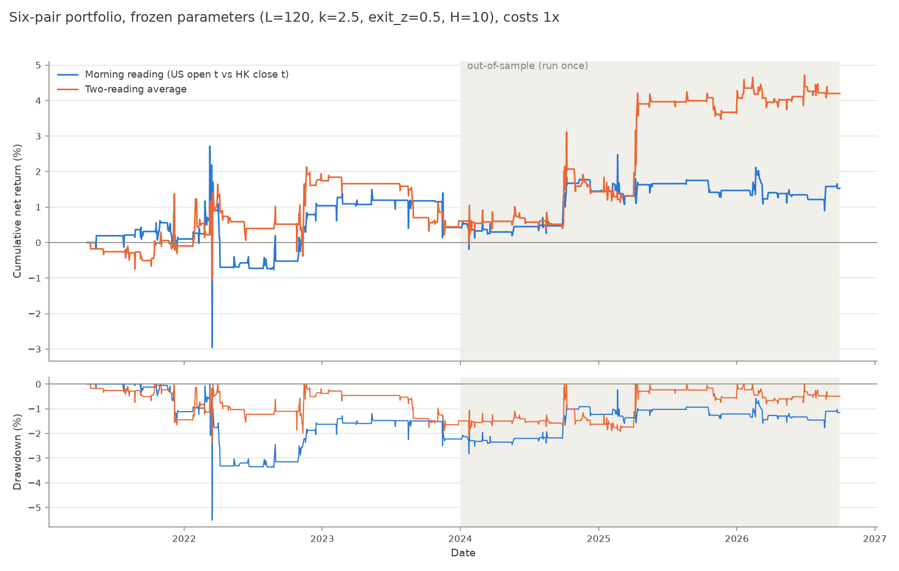

**Fabianus Harry Setiawan** · Submitted 20 October 2026
**One Company, Two Prices: Mean Reversion in US–Hong Kong Dual-Listed Chinese Equities**

Deliverables: this report, `notebook.ipynb` (runs end to end from the data snapshot), `data/` (raw snapshot and processed spreads). Supporting code is in `src/` (unit-tested in `tests/`); every log referred to below is in `results/logs/`.

---

## 1. Hypothesis Pitch

**The pattern.** Six Chinese companies trade both as ADRs in New York and as ordinary shares in Hong Kong: Alibaba, JD.com, NetEase, Yum China, Baidu and Trip.com. After adjusting for the ADR ratio and USD/HKD, the two prices should be equal. My hypothesis was that the gap between them mean-reverts to its recent average within a few trading days, and that a market-neutral position (long the cheap listing, short the rich one), opened when the gap exceeds about two standard deviations, can capture that convergence after realistic costs.

**Why it might be true.** The two listings are claims on the same share and are convertible through the depositary bank, so a persistent gap invites arbitrage. But arbitrage here is limited. The markets never trade at the same time, conversion takes days and costs fees, shorting either leg costs borrow, and the investor bases differ. Stock Connect sharpens the last point: mainland investors can buy the Hong Kong leg but not the ADR, creating one-sided demand. Gaps should therefore open (segmented flows, news arriving while one market is shut) and close only partially and with a lag. This is a limits-to-arbitrage setting, not a free lunch.

**What would prove me wrong** (fixed before any data were examined):
- **(a)** In-sample spreads show no meaningful mean reversion: a half-life above about 20 trading days, or an AR coefficient not significantly below one.
- **(b)** The out-of-sample Sharpe ratio after realistic costs is at or below zero.
- **(c)** The break-even cost is lower than what a real trader would pay, i.e. the gaps exist but are no larger than the frictions that keep them open.

A secondary question, examined only after the strategy was frozen: did Alibaba's inclusion in Southbound Stock Connect (10 September 2024) change its spread?

---

## 2. Data Pipeline

**Sources.** All data are public and downloaded programmatically:
- Daily open/high/low/close/volume, dividends and splits for the 12 listings, plus HKD=X, from Yahoo Finance via `yfinance` (`auto_adjust=False`, `repair=False`, `keepna=True`).
- Exchange calendars (XNYS, XHKG) from `exchange_calendars`.
- ADR ratios from the depositary banks' directories (Deutsche Bank, Citi) and company filings, recorded with sources in `docs/HOLDOUT_VERIFICATION.md`.

**Snapshot.** `src/data.py` downloads once (2019-01-01 to 2026-10-07, wider than the 2021-04-19 to 2026-09-30 sample so rolling windows can warm up) and writes one dated CSV per ticker to `data/raw/` with a `manifest.json`. Everything afterwards reads the snapshot offline. While the out-of-sample period was locked, the loader raised an error for any date from 2024 onwards.

**Messiness handled, never silently dropped.** Every decision below is written to a log with its reason.

| Issue | Handling | Log |
|---|---|---|
| Days when only one market traded | Kept only days both legs traded. Each dropped day is labelled: HK holiday (64 per pair), US holiday (37–38), HK weather closures missing from the calendar (2: Typhoon Saola and a black rainstorm, Sep 2023) | `dropped_dates.csv` |
| Yahoo's fake HK bars (open = high = low = close, zero volume) | On half-days the close is real, so the bar is kept with the open marked unreliable. On normal days (2022-03-14, 2024-01-15) the close is wrong, so the date is dropped | `hk_bar_flags.csv` |
| FX timing and gaps | HKD=X close of the **previous** day, because Yahoo stamps its FX close after the US open. Forward-filled at most one day; one date dropped where two consecutive days were missing | `fx_fills.csv` |
| Dividends on different ex-dates in the two markets | Matched by date and amount (60 events); the dividend is added back to the leg that went ex first, for the signal only (20 mismatches) | `dividend_corrections.csv` |
| Missing dividends in Yahoo | 2 Yum China US dividends (Sep and Dec 2025) absent. Checked: no position was open across them | `dividend_corrections.csv`, notebook |
| Splits and ADR ratio changes | NetEase's ADR ratio change (25 → 5, Oct 2020) appears as a Yahoo split before the sample; ratios constant within the sample | `raw_quality.csv` |
| Extreme spreads (\|s\| > 10%) | 6 flagged and reviewed; all one-day news spikes (e.g. Alibaba 2023-03-28), kept | `spread_flags.csv` |

**Spread.** For pair *i* on day *t*: `s(t) = ln(US open_t) − ln(N × HK close_t / FX_{t−1})`. Hong Kong closes (16:00 HKT) before New York opens (09:30 ET), so both prices are known at the US open. Prices are **not** dividend-adjusted, because back-adjustment rewrites each listing's history differently and would distort the spread level.

---

## 3. Strategy and Backtest

**Diagnosis first (in-sample only).** The spread looked strongly mean-reverting: AR(1) slopes of −0.75 to −0.98, half-lives of 0.2–0.5 days, ADF rejecting a unit root for every pair. But two diagnostics showed that most of this is **timing noise**. The HK price is 5½–6½ hours stale at the US open and catches up at the next HK open, which no trader can capture:
- Measuring the same pair 12 hours later with the *other* leg stale gives readings that barely correlate (−0.01 to 0.28).
- 38–66% of each pair's variance is shared across all six pairs (China-wide news), so the six pairs behave like about 2 independent bets.

A small genuinely persistent component exists (clearest for Yum China). Before any backtest I added a **pre-registered secondary signal**: the average of the morning reading and an evening reading (previous US close vs today's HK open), whose timing noise comes from a different news window and partly cancels.

**Signal and rules.** `z = (s − rolling mean) / rolling std`, both over the previous L days up to t−1. Positions are held in the spread: +1 = long US / short HK.

| Situation | Action |
|---|---|
| Flat and k < z ≤ 4 (ADR rich) / −4 ≤ z < −k (ADR cheap) | Enter −1 / +1 |
| z back past exit_z (direction-aware) | Exit (reverted) |
| \|z\| > 4 | Exit, and never enter: a move that large is news, not mispricing |
| Held H decision days | Exit |
| Exit day | No re-entry the same day |

**Execution.** The signal is known at the US open on day t. The US leg trades at the **US close on t**, and the HK leg at the **next HK open**. Each leg buys shares worth 50% of pair equity and **holds the share count** until exit. Each leg is marked to market on its own exchange calendar in USD with cash dividends. Pairs are equally weighted (1/6 each); idle cash earns nothing. Costs are deducted as they occur (Section 5). The engine was verified against a hand-built, independent shares-and-dollars ledger to 10⁻¹², and by a placebo test (Section 5, look-ahead).

**Parameters.** A 72-run in-sample grid (L ∈ {20, 60, 120}, k ∈ {1.5, 2.0, 2.5}, exit_z ∈ {0, 0.5}, H ∈ {5, 10}, × 2 signals) at 1× costs, with every run logged. I chose a setting on a plateau rather than the best cell: **L = 120, k = 2.5, exit_z = 0.5, H = 10, stop at |z| = 4**, the same for both signals. It was frozen and committed (9 Oct 2026, `efd5e08`) before the out-of-sample data were unlocked (`fef6322`).

### Key results (six-pair portfolio, frozen parameters, costs 1×)

| Signal | Period | Cumulative return | Sharpe (net) | Sharpe (gross) | Max drawdown | Trades |
|---|---|---|---|---|---|---|
| Morning (primary) | In-sample 2021-04-19 → 2023-12-29 | +0.42% | 0.06 | 0.36 | −5.52% | 75 |
| Morning (primary) | **Out-of-sample** 2024-01-01 → 2026-09-30 | **+1.10%** | **0.22** | 0.88 | **−1.54%** | 60 |
| Two-reading (secondary) | In-sample | +0.60% | 0.08 | 0.51 | −2.40% | 72 |
| Two-reading (secondary) | **Out-of-sample** | **+3.57%** | **0.50** | 1.16 | **−1.92%** | 80 |

**Reading the results.**
- **Small and statistically indistinguishable from zero.** OOS annual returns are 0.40% and 1.29%; the strategy holds positions on only 2.5–4.2% of decision days, and trades last 1.5–2 days. The t-statistics are 0.37 and 0.83, against a Sharpe standard error of about 0.6 over 2.7 years.
- **The profit is a few trades.** In the morning signal, the top 3 of 60 trades provide 131% of the profit; without them the result is −0.29%. In the two-reading signal, the top 3 of 80 provide 82%. They cluster on market shocks (the September 2024 China stimulus rally and the April 2025 tariff shock).
- **Pair results flip sign between periods.** For example, NetEase is best in-sample and worst out-of-sample.

**Costs decide the outcome.** Net Sharpe at 0 / 0.5 / 1 / 2× costs is 0.88 / 0.55 / 0.22 / −0.43 (morning, OOS) and 1.16 / 0.83 / 0.50 / −0.14 (two-reading, OOS). The break-even cost multiplier is 1.18–1.19× in-sample and 1.34× / 1.78× out-of-sample.

**Execution upper bound (not tradable).** Filling the US leg at the US open, the moment the signal is computed, raises the morning OOS Sharpe from 0.22 to 0.78. Most of that signal's edge is gone by the US close. The two-reading signal barely changes (0.50 → 0.53).

**Out-of-universe check.** Seven dual listings never used before were chosen by a rule fixed in advance: Bilibili, XPeng, Li Auto, Hutchmed, NIO, ZTO, GDS. The rule excluded ratio, ticker or domicile changes and HK lines trading under HKD 20m a day, and set half-spreads by HK liquidity tier. With the same frozen code and parameters, gross Sharpe is 0.36–0.75 but net Sharpe is 0.03 / −0.00 in-sample and **−0.04 / +0.04 out-of-sample**. The main basket's best result (0.50) does not replicate.

**Stock Connect.** Alibaba's spread level changed by +0.03 pp (morning) and −0.17 pp (two-reading) over ±120 trading days around inclusion. That is inside the range of five comparison pairs whose Connect status did not change (rank 3 and 5 of 6). No HK premium appeared. Alibaba's volatility rose most, but so did Yum China's (already in Connect), and the window contains the stimulus rally two weeks after inclusion, so the volatility rise cannot be attributed to Connect.

**Against the falsification tests.**
- **(a) Not triggered, but for a weaker reason than hoped.** The AR coefficient (1 + slope ≈ 0.02–0.34) is far below one, but most of that reversion is untradable timing noise.
- **(b) Not triggered on the point estimates** (0.22 and 0.50 > 0). It **is** effectively triggered once uncertainty is considered: neither is significant, and the out-of-universe basket is at zero.
- **(c) Borderline at best.** Break-even sits only 18–78% above modelled costs, and the modelled costs are optimistic (Section 5). On unseen pairs, break-even is about 1×.

**Conclusion:** the hypothesis is not supported after realistic costs.

---

## 4. Methodology Defense

- **Universe.** These six are the most liquid Chinese companies with a sponsored US ADR and an HK listing that existed by April 2021, so the panel is balanced over the whole sample. Yum China and Trip.com (ratio 1:1) make errors easy to spot. *If wrong:* a mis-stated ratio would create a constant fake spread. Ratios were verified against the depositary directory, and a market check (US price × FX ÷ HK price) holds flat at the stated ratio every quarter.
- **Train/test split.** The sample starts at Trip.com's HK listing (2021-04-19). The in-sample period (to 2023) contains the 2022 US-delisting scare, so the design saw a stress regime. The out-of-sample period (about 2.75 years) was opened once, after freezing. *If wrong:* a split that let OOS information leak into the design would invalidate the test. The git history shows the parameter freeze, the out-of-universe pre-registration and the Connect design were all committed before OOS was unlocked.
- **Spread construction.** The **US open vs HK close** pairing is used because that is the latest moment both prices are known; comparing same-day closes would use an HK price known 12 hours *before* the US one as if they were simultaneous. FX uses the previous day's close for the same reason. *If wrong:* using same-day FX or closes would put future information into the signal.
- **Signal construction.** A rolling z-score adapts to each pair's typical gap and volatility, and the rolling mean removes the persistent ADR discount (−0.1% to −0.5%, present in both readings, so a real level and not a timing artefact). No entry beyond |z| = 4, because such moves are news; this was decided from in-sample diagnostics before any backtest. The two-reading variant was pre-registered for the same reason. *If wrong:* treating the timing noise as mispricing would produce trades with no edge. The placebo test bounds this.
- **Execution and accounting.** The US leg cannot trade at the open it is computed from, so it trades at the close; HK can trade next at its own open. P&L comes from each leg's actual fill prices and share counts, **never from spread changes**. *If wrong:* spread-change P&L credits the stale-HK catch-up and shows a Sharpe of 5.8 on a market with no mispricing at all (Section 5).
- **Holding shares, not rebalancing daily.** My first engine reset each leg to 50% of equity daily, which an independent ledger showed overstated a test trade (+1.72% vs +1.46%) and made rebalancing free. The engine now holds share counts, as a trader would.
- **Costs.** See Section 5. They are fixed per side so the break-even multiplier has a clear interpretation.
- **Parameter choice.** A plateau (good neighbourhood) rather than the best cell: the H = 5 cell scored 0.15 because of a single JD trade.

---

## 5. Pitfall Checklist

### Look-ahead bias
**How checked:**
- Every input is dated at its decision time: US open vs HK close (HK closes first), FX of t−1, rolling statistics with `.shift(1)`, US fill at the close of t, HK fill at the next open.
- Dividend add-backs use declared dividends, which are announced weeks before the ex-date.
- Unit tests: perturbing all spreads or all prices *after* a date leaves every position and every P&L value up to that date unchanged.
- A **placebo test** simulates two listings of one perfectly priced stock observed at the real session times: 1,119 trades over 40 simulated years, gross Sharpe **+0.05**. The common shortcut (P&L from spread changes) shows **+5.76** on the same trades.
- Rebuilding the spreads with OOS data left all 4,779 in-sample rows identical.

**Found:** no look-ahead in the decision path. One residual use of hindsight is the choice of universe (see the next item).

### Survivorship bias
**How checked:** the six pairs were chosen in 2026, and all are still dual-listed, so the universe is conditioned on survival. No company in it was delisted, acquired or privatised during the sample. The out-of-universe rule also required candidates to remain dual-listed through 2026-09-30, so it shares the bias.

**How including them would change results:** a pair whose ADR is being delisted (the 2022 US delisting threat) or taken private is exactly where the gap can widen and never close, so a convergence strategy would lose there. Including such names would most likely make results **worse**. Since the result is already indistinguishable from zero, this strengthens the negative conclusion rather than threatening a positive one.

### Overfitting/data-snooping
**How checked:**
- Parameters were tuned only on 2021–2023, choosing a plateau and not the best cell.
- **166 runs are logged** in `results/grid_log.csv`: 72 grid runs, 2 smoke runs before costs existed, and 92 runs after freezing (OOS, sensitivity, break-even search, upper bound, out-of-universe). None of the post-freeze runs changed the parameters.
- The two design changes (no entry beyond |z| = 4; the two-reading variant) were made from descriptive diagnostics before any backtest, and both are reported.

**Found:**
- The best in-sample net Sharpe (0.15) is far inside the noise of a 72-trial search; the standard error alone is about 0.6.
- The chosen setting sits at the edge of the grid, which I did not extend, to avoid further searching.
- Out-of-sample came out better than in-sample, which points to a more volatile period rather than an overfit model. The out-of-universe test, where the best variant fell to zero, is the stronger evidence against a fitted result.

### Transaction costs and slippage
**Assumptions** (per side, as a fraction of traded value):
- HK stamp duty 0.10% and exchange levies 0.01% (statutory rates)
- commission 0.03% on both legs
- half bid-ask spread 0.05% (Alibaba, JD) or 0.10% (others), set by liquidity
- short borrow 1% a year, accrued per calendar day

A round trip costs 0.54–0.74% of one leg's value.

**What is not modelled, and pushes real costs higher:**
- market impact
- fills at the exact auction prices
- whether an HK short can be placed at the opening auction
- spreads widening in stress
- HK stamp duty was actually **0.13%** from August 2021 to November 2023, about 1.1× the in-sample cost level

**Found:** the gross edge is real (gross Sharpe positive in all 72 grid cells), but costs absorb it. Net Sharpe falls from 0.88 to 0.22 (morning, OOS). Break-even is 1.18–1.78× modelled costs; 2× costs make every variant negative. In the out-of-universe test, stamp duty and the HK leg are the largest cost (about 60%); borrow is negligible because trades last about 2 days.

### Out-of-sample validation
**Held out:**
- 1 January 2024 – 30 September 2026, run once with frozen parameters.
- Seven additional dual listings never used in design, selected by a rule committed before any OOS result.

**Comparison:** see the key results table. OOS net Sharpe (0.22 / 0.50) exceeds in-sample (0.06 / 0.08), but neither is significant (t = 0.37 / 0.83), the profit is concentrated in a few shock-driven trades, and the out-of-universe portfolio earns nothing net (−0.04 / +0.04 OOS).

---

## 6. Efficiency Touchpoint

**The most expensive step is the in-sample parameter grid**, and with it the break-even search, which reruns the backtest repeatedly.
- One backtest runs the position state machine and the share-holding book for each pair. Each is a single loop over T trading days with constant work per day, so one run costs **O(P·T)** (P = 6 pairs, T ≈ 700–1,400 days).
- The grid repeats this for G = 72 settings: **O(G·P·T)**.
- Measured: **72 runs in 21.2 s (0.29 s per run)**. The break-even bisection adds 14 runs per case.

A loop is used because each day's position depends on the previous day's; it is O(T), not O(T²), so it is acceptable at this scale. If the universe or grid grew, the runs are independent and could be parallelised across settings. Pairwise correlations (O(P²·T)) and rolling statistics (O(T) in pandas) are negligible by comparison.

---

## 7. Risk Touchpoint

**Sizing and leverage.** No leverage: each pair gets 1/6 of capital and each leg 50% of that, so gross exposure is at most 1×. In practice it is far lower, because positions are open on only 2.5–4.2% of decision days. That is why drawdowns look small (−1.5% to −5.5%); per unit of capital actually deployed, the risk is much larger.

**The hedge is imperfect:**
- Each leg holds shares, so leg values drift apart during a trade.
- The two legs are not open at the same time. Between the US fill (close) and the HK fill (next open), the position is one-legged for about 5½ hours of overnight gap risk.

**Concentration.** The six pairs share China-wide news: the average correlation of daily spread changes is 0.46, which is only about 2 independent bets. Profit comes from a handful of trades.

**A plausible bad scenario** is a repeat of the 2022 US-delisting scare or a sudden capital-control or Connect policy shock. Gaps would widen persistently in the same direction across all pairs, the stop at |z| = 4 would close positions at a loss, borrow on the HK or US short could become expensive or be recalled, and liquidity in the thinner HK lines would vanish. Hutchmed in the out-of-universe test shows the mechanism: its gap was the most persistent and it lost money out-of-sample.

---

## 8. Reflection

**What I learned.**
- An apparently fast mean reversion can be a measurement artefact. When two markets never overlap, comparing their prices creates a spread that "reverts" mechanically as the stale price catches up.
- The most valuable code I wrote was a test with a known answer of zero: the placebo. It showed how easily a backtest can turn that artefact into a Sharpe of almost 6.
- Accounting details matter at this scale: summing daily returns, and assuming free daily rebalancing, each moved a test trade by about a quarter of a percentage point.

**What was wrong in my original assumptions.**
- I expected gaps to close over a few days. Most "gaps" were gone within hours, and the tradable part was small.
- I treated Stock Connect as a likely source of HK premiums; Alibaba's inclusion left no visible mark.
- I assumed data vendors agree. Citi's directory gave the wrong ADR ratio for two candidates, and Yahoo was missing some US dividends. Market-implied ratios and cross-checks caught them.
- I underestimated costs. HK stamp duty alone is 27–37% of a round trip, and it was higher than my model assumed for most of the in-sample period.

**Next steps.**
- **Measure the gap when both prices are live.** Use intraday data: US pre-market against HK futures or the HK close, or HK night futures. This removes the timing noise instead of averaging it away.
- **Trade only dislocation episodes.** The profit came from shocks, so test an event-conditional version on a longer history.
- **Lower the cost base.** Model an arbitrageur that is exempt from stamp duty or can convert ADRs to shares directly; that changes break-even more than any parameter does.
- **Validate further.** Add the walk-forward re-tuning planned in the original specification, and a longer sample, before any capital is committed.

---

## References

- Shleifer, A. and Vishny, R. W. (1997). The limits of arbitrage. *Journal of Finance*, 52(1), 35–55.
- Gagnon, L. and Karolyi, G. A. (2010). Multi-market trading and arbitrage. *Journal of Financial Economics*, 97(1), 53–80.
- Lo, A. W. and MacKinlay, A. C. (1990). An econometric analysis of nonsynchronous trading. *Journal of Econometrics*, 45(1–2), 181–211.
- Data: Yahoo Finance (via `yfinance`); Deutsche Bank and Citi depositary receipt directories; HUTCHMED investor FAQ (ADS ratio); Hong Kong Inland Revenue Department (stamp duty); HKEX (Stock Connect eligibility).
